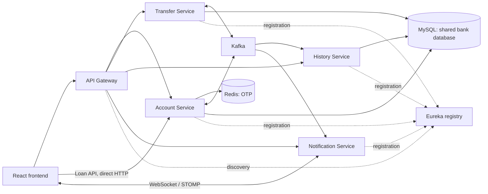

# Banking Microservices

An educational online banking application built with **Java 17, Spring Boot, Kafka, and React**. It explores service discovery, asynchronous transfers, compensating actions, and real-time balance notifications.

**Work in progress.** The features below exist in source code; end-to-end correctness, full coursework compliance, and production readiness have not been established. Use fictional accounts and funds only.

## Features

- Registration with email OTP, login, and password reset.
- Account creation, lookup, and balance display.
- Asynchronous transfers with status polling and compensation handling.
- Kafka-based transaction history collection.
- Email and WebSocket/STOMP balance notifications.
- QR code generation and scanning.
- Loan applications, approval/disbursement, and repayments.
- Vietnamese and English frontend translations.

See [Current limitations](#current-limitations) before running a demo.

## Architecture



| Module | Responsibility | Local port |
| --- | --- | --- |
| `frontend` | React application | 5173 |
| `api-gateway` | HTTP routing | 8080 |
| `discovery-service` | Eureka registry | 8761 |
| `account-service` | Users, accounts, balances, OTP, loans | 8081 |
| `transfer-service` | Transfer initiation and status | 8082 |
| `notification-service` | Email delivery and WebSocket notifications | 8083 |
| `transaction-history-service` | Kafka consumption and history queries | 8084 |
| `bank-common` | Shared DTOs, events, exceptions; Maven library | — |

### Transfer flow

1. The frontend submits a transfer through the gateway.
2. Transfer Service stores a transaction and publishes `TRANSACTION_CREATED` on `banking.transaction`.
3. Account Service debits the sender and publishes `MONEY_DEDUCTED`.
4. Account Service credits the recipient and emits a completion event. If crediting fails, compensation handling attempts to refund the sender.
5. Transfer Service updates the status to `SUCCESS` or `FAILED`. History and notification consumers process the relevant events.

The initial HTTP response is not confirmation of completion: the client polls transaction status. This is a Saga-style learning implementation; duplicate event handling, concurrent updates, and recovery guarantees still require testing and hardening.

## Technology stack

| Layer | Technologies |
| --- | --- |
| Backend | Java 17, Spring Boot 3.3.4, Spring Cloud Gateway, Eureka |
| Persistence | Spring Data JPA / Hibernate, MySQL 8 |
| Messaging / cache | Confluent Kafka 7.7.1 images, ZooKeeper, Redis 7 |
| Notifications | Spring Mail, SMTP, Thymeleaf, WebSocket, STOMP, SockJS |
| Frontend | React 19, Vite 7, Ant Design, Axios, React Router, i18next |
| Tooling | Maven, npm, Docker Compose, Nginx |

## Getting started

### Prerequisites

- Git and Docker with the Compose plugin; the Docker engine must be running.
- JDK 17 and Maven 3.8+ for local backend processes. Maven wrappers are not included.
- Node.js 22.12+ with npm, matching the installed Vite engine requirements.
- An SMTP account and app password for email OTP and notifications.

Commands below use **PowerShell**, from the repository root unless stated otherwise.

### 1. Clone and configure

```powershell
git clone https://github.com/anhpd-glinteco/banking-microservices.git
cd banking-microservices
Copy-Item .env.example .env
```

Edit `.env` to supply your own `MAIL_USERNAME` and `MAIL_PASSWORD`. Never commit real credentials. Database credentials in the examples are local demo defaults.

The root `.env` is consumed by Docker Compose; Maven-started Spring Boot processes do **not** automatically load it. Set the following environment variables in each relevant backend terminal:

```powershell
$env:DB_HOST = 'localhost'
$env:SPRING_REDIS_HOST = 'localhost'
$env:KAFKA_BOOTSTRAP_SERVERS = 'localhost:29092'
$env:MAIL_USERNAME = 'your-email@example.com'
$env:MAIL_PASSWORD = 'your-smtp-app-password'
```

Only Notification Service needs mail variables. Replace the placeholders before testing OTP delivery. Other local defaults are MySQL port `3306`, database `bank`, username/password `bank`, Redis port `6379`, and Eureka at `http://localhost:8761/eureka/`.

### 2. Start infrastructure

```powershell
docker compose -f compose.yml up -d mysql redis zookeeper kafka kafka-ui
docker compose -f compose.yml ps
```

Wait for MySQL, Redis, ZooKeeper, and Kafka to become healthy. [Kafka UI](http://localhost:8090) is exposed on port 8090. Use `-f compose.yml` explicitly: older Compose definitions also exist with different settings. These commands start infrastructure only.

### 3. Install the shared library and start backend services

```powershell
mvn -f bank-common/pom.xml clean install
```

Run **each following command in a separate terminal**, starting Discovery Service first. Apply the environment variables above in the relevant terminals.

```powershell
mvn -f discovery-service/pom.xml spring-boot:run
mvn -f api-gateway/pom.xml spring-boot:run
mvn -f account-service/pom.xml spring-boot:run
mvn -f transfer-service/pom.xml spring-boot:run
mvn -f transaction-history-service/pom.xml spring-boot:run
mvn -f notification-service/pom.xml spring-boot:run
```

Check registration in [Eureka](http://localhost:8761). Each application exposes `/actuator/health` on its own port, for example:

```powershell
Invoke-RestMethod http://localhost:8081/actuator/health
```

JPA currently uses `ddl-auto: update`. No versioned migrations or seeded demo accounts are supplied. Register test users through the UI after configuring SMTP.

### 4. Start the frontend

```powershell
cd frontend
npm ci
npm run dev
```

Open [localhost:5173](http://localhost:5173). The general API client reads `VITE_API_URL`, defaulting to `http://localhost:8080`. To override it, create `frontend/.env` containing:

```dotenv
VITE_API_URL=http://localhost:8080
```

Restart Vite after changing it. Loan requests currently call `http://localhost:8081` directly; WebSocket connections use `http://localhost:8083/ws`. Those addresses do not follow `VITE_API_URL`.

### Application containers and troubleshooting

`compose.yml` also defines application containers, but full-stack container startup has not been verified. The frontend Dockerfile uses Node 21, outside the installed Vite engine range. Backend health checks invoke `curl` without explicitly installing it. Treat full-stack Docker execution as pending work; the workflow above runs applications locally.

```powershell
docker compose -f compose.yml logs --tail=100 kafka mysql
docker compose -f compose.yml down
```

Stop local Maven/Vite processes with `Ctrl+C`. Infrastructure data is bind-mounted under `data/`; bringing Compose down preserves it. Deleting that directory destroys local database and messaging data.

## API overview

Most frontend HTTP calls use the gateway at `http://localhost:8080`.

| Method | Path | Purpose |
| --- | --- | --- |
| POST | `/api/accounts/users/register-with-otp` | Register with OTP |
| POST | `/api/accounts/otp/generate?email=...` | Request OTP |
| POST | `/api/accounts/login` | Log in |
| POST | `/api/accounts` | Create account |
| GET | `/api/accounts/{id}` | Read account |
| GET | `/api/accounts/number/{accountNumber}` | Look up account |
| POST | `/api/accounts/forgot-password?email=...` | Request password recovery |
| POST | `/api/accounts/reset-password` | Reset password using query parameters |
| POST | `/api/transfers` | Initiate transfer |
| GET | `/api/transfers/{transactionId}/status` | Poll status |
| GET | `/api/history/{accountId}` | Read history; account filtering currently missing |

Loan APIs use Account Service directly at `http://localhost:8081`:

| Method | Path | Purpose |
| --- | --- | --- |
| POST | `/api/loans/apply` | Apply for loan |
| GET | `/api/loans/account/{accountId}` | List loans |
| GET | `/api/loans/{loanId}` | Read loan |
| POST | `/api/loans/{loanId}/approve` | Approve and disburse |
| POST | `/api/loans/{loanId}/repay` | Submit repayment |

This describes current controllers, not a versioned API contract. DTOs are in `bank-common`; loan endpoints use map-based bodies. Validation and authorization need further work.

## Current limitations

- Passwords are compared directly. Password hashing, authenticated sessions/tokens, role checks, and account ownership enforcement need implementation before real use.
- History queries currently return all records rather than filtering by the requested account. Do not load real personal or financial data.
- Account, Transfer, and History share the `bank` database by default.
- There is no business REST call between services. Kafka messaging alone does not satisfy the coursework requirement for REST integration.
- CRUD coverage, pagination, DTO validation, and dependency failure handling such as HTTP 503 are incomplete.
- No automated tests or Postman collections are committed to demonstrate rollback, compensation, or integration failures.
- Full Docker startup, versioned database migrations, CI, and deployment verification remain pending.

## Roadmap

This is a **proposed completion path**, not a finalized specification or a claim of coursework completion. Reconcile each milestone with the actual assignments and grading criteria. TH4 priorities reflect the earlier source review; other practical assignments have not yet been mapped.

| Milestone | Planned work | Completion evidence |
| --- | --- | --- |
| 1. Reproducible demo | Verify fresh-clone setup; align container runtime versions, health checks, and frontend addresses; prepare fictional demo data | Registration → transfer → notification walkthrough |
| 2. TH4 alignment | Separate databases; add required business REST integration with 404/503 handling; complete required CRUD, queries, pagination, validation, and service layering | Requirement checklist, data/service design, database and sequence diagrams, executable request examples |
| 3. Transaction correctness | Fix account-specific history; test successful and failed transfers, compensation, concurrent updates, duplicate events, and loan rollback | Automated tests proving consistent balances, isolated history, and expected transaction states |
| 4. Security baseline | Hash passwords; enforce authentication, roles, ownership, loan approval permissions, and WebSocket access; improve secret handling | Tests rejecting unauthorized and cross-account operations; no tracked credentials |
| 5. Submission and delivery | Map remaining assignments; add CI, setup checks, screenshots, and demo guide; verify container deployment | Reproducible build/test results and requirement-to-evidence checklist |

These are planning checkpoints, not permission to deploy intermediate versions. No deadlines or additional banking features are assumed.

## Project origin

Based on a source snapshot of [sonnn128/bank-system-microservice](https://github.com/sonnn128/bank-system-microservice), commit `b44d77e`, continued for coursework and learning. Existing package names are retained to reflect that origin.

This publication starts a new Git history to avoid carrying embedded SMTP credentials from the source history. Supply your own credentials locally. Previously exposed credentials must be revoked by their owner; deleting them here does not revoke them.

No project license file was present in the imported snapshot. No new license is asserted for the original work; confirm the original author's terms before redistribution or other reuse.
