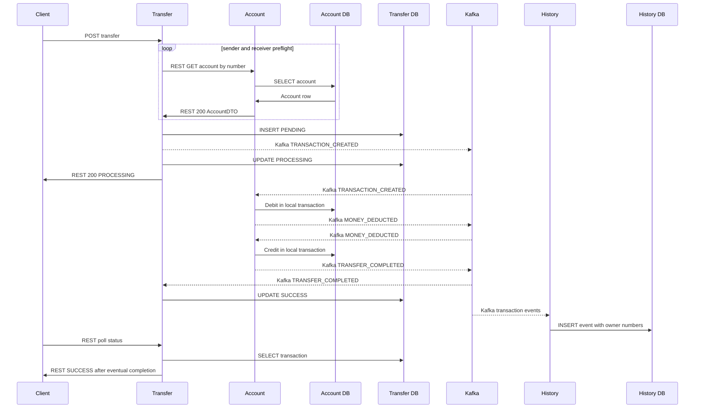
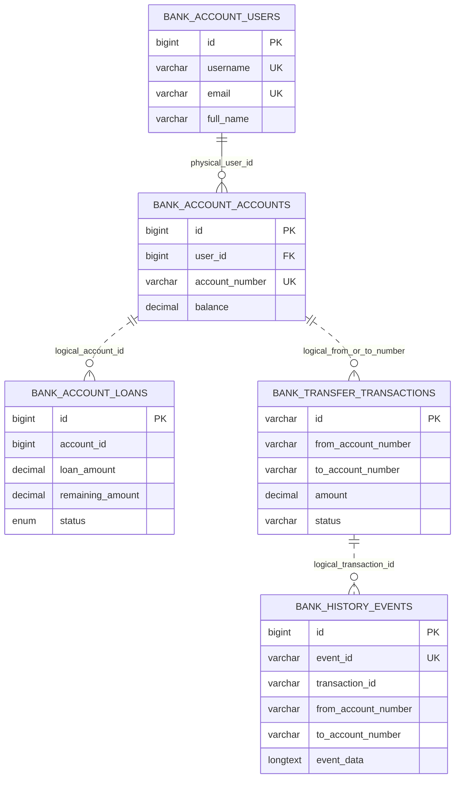

# TH4 — Thiết kế dữ liệu và giao tiếp dịch vụ ngân hàng

Bản nộp dùng dữ liệu giả trong MySQL riêng; kết quả kiểm tra liên kết ở mục 9–10. Java 17, Spring Boot 3.3.4, Maven 3.9.9, Node 22. Đây là thiết kế ngân hàng áp dụng TH4, không thay thế bài Patient/Appointment nếu giảng viên yêu cầu phần đó.

## 1. Danh sách service

| Thành phần | Vai trò | Cổng ứng dụng |
| --- | --- | --- |
| Account Service | User profile, tài khoản, khoản vay; debit/credit/compensation | 8081 |
| Transfer Service | REST preflight hai tài khoản, tạo và theo dõi saga chuyển tiền | 8082 |
| Transaction History Service | Lưu Kafka event, truy vấn lịch sử đúng accountNumber | 8084 |
| Notification Service | Email/WebSocket từ event; không chạy trong fixture, không gửi SMTP | 8083 |
| API Gateway | Định tuyến client | 8080 |
| Discovery Service | Eureka discovery | 8761 |

`bank-common` là thư viện DTO/event/exception, không phải service. Frontend React/Vite gọi API; fixture gọi trực tiếp ba service nghiệp vụ, không cần Gateway/Discovery/Notification.

## 2. Database từng service

| Owner | MySQL schema / user | Bảng |
| --- | --- | --- |
| Account | `bank_account` / `account_app` | `users`, `accounts`, `loans` |
| Transfer | `bank_transfer` / `transfer_app` | `transactions` |
| History | `bank_history` / `history_app` | `transaction_history` |

Ba DB có thể nằm trên cùng MySQL server; mỗi user chỉ có SELECT/INSERT/UPDATE/DELETE/CREATE/ALTER/INDEX/REFERENCES trên DB của mình. Không đọc DB service khác, không FK xuyên DB. Datasource dùng DB_HOST/DB_PORT và ACCOUNT/TRANSFER/HISTORY_DB_NAME/USER/PASSWORD riêng. Redis giữ OTP tạm thời; Kafka giữ event, không thay thế DB nghiệp vụ. Gateway/Discovery/Notification không sở hữu bảng nghiệp vụ giả.

Fixture `compose.th4-test.yml` dùng MySQL 8.0.46, Kafka 4.0.1 KRaft, Redis 7.4.2. Project cố định `bank-th4-test`, không container_name; volume riêng theo `TH4_FIXTURE_ID` ngẫu nhiên, không bind dữ liệu repo. Mặc định host MySQL/Kafka/Redis 13306/39092/16379; lượt nghiệm thu dùng **23306/49092/26379** để cùng tồn tại fixture T02 cũ. Account/Transfer/History dùng 18081/18082/18084. Tất cả publish loopback; nội bộ Docker dùng mysql:3306, kafka:9092, redis:6379.

## 3. Entity, kiểu và ràng buộc

Tên Java camelCase ánh xạ snake_case trong MySQL. `DB NULL` ghi khả năng nullable của schema JPA; required/validation HTTP là ràng buộc riêng, không suy ra DB NOT NULL từ DTO. Timestamp tạo/cập nhật do Hibernate ghi; bảng vẫn cho NULL khi entity không khai báo nullable=false.

| Entity / field Java | Java → MySQL | PK, DB constraint / DB NULL | Quy tắc API liên quan |
| --- | --- | --- | --- |
| User.id | Long → BIGINT | PK, AUTO_INCREMENT, NOT NULL | Do server tạo |
| User.username | String → VARCHAR(255) | UNIQUE, NOT NULL | create nonblank, max255; PATCH không sửa |
| User.email | String → VARCHAR(255) | UNIQUE, NOT NULL | create nonblank, email, max255; PATCH không sửa |
| User.password | String → VARCHAR(255) | NULL | create nonblank/max255; không có trong DTO profile response |
| User.fullName | String → VARCHAR(255) | NULL | create optional/max255; PATCH required nonblank/max255 |
| User.phone | String → VARCHAR(255) | NULL | optional/max255 |
| User.identificationNumber | String → VARCHAR(255) | NULL, không UNIQUE | create optional/max255; PATCH không sửa |
| User.createdAt, updatedAt | LocalDateTime → DATETIME(6) | NULL | Hibernate timestamps, không nhận từ CRUD request |
| AccountBank.id | Long → BIGINT | PK, AUTO_INCREMENT, NOT NULL | server tạo |
| AccountBank.user | User → user_id BIGINT | NOT NULL, FK → bank_account.users.id; không cascade remove | userId positive, phải tồn tại |
| AccountBank.accountNumber | String → VARCHAR(255) | UNIQUE, NOT NULL | nonblank/max255 |
| AccountBank.balance | BigDecimal → DECIMAL(15,2) | NOT NULL | optional lúc tạo, mặc định0; nonnegative, 13 chữ số nguyên/2 thập phân |
| AccountBank.accountName | String → VARCHAR(255) | NULL | optional/max255 |
| AccountBank.createdAt, updatedAt | LocalDateTime → DATETIME(6) | NULL | Hibernate timestamps |
| Loan.id | Long → BIGINT | PK, AUTO_INCREMENT, NOT NULL | server tạo |
| Loan.accountId | Long → BIGINT | NOT NULL; scalar logical reference, **không physical FK** | accountId positive, service kiểm tra tồn tại |
| Loan.loanAmount, remainingAmount | BigDecimal → DECIMAL(15,2) | NOT NULL | apply amount10,000,000..10,000,000,000; repayment positive và không quá remaining |
| Loan.interestRate | BigDecimal → DECIMAL(5,2) | NOT NULL | service tính |
| Loan.termMonths | Integer → INT | NOT NULL | 6..360 |
| Loan.purpose | String → VARCHAR(255) | NOT NULL | nonblank/max255 |
| Loan.status | LoanStatus → ENUM | NOT NULL; PENDING/APPROVED/ACTIVE/PAID_OFF/REJECTED/DEFAULTED | service điều khiển, không generic PATCH |
| Loan.monthlyPayment | BigDecimal → DECIMAL(15,2) | NULL | service tính |
| Loan.approvedAt, disbursedAt | LocalDateTime → DATETIME(6) | NULL | đặt khi approve |
| Loan.createdAt, updatedAt | LocalDateTime → DATETIME(6) | NULL | Hibernate timestamps |
| Transaction.id | String → VARCHAR(255) | PK, NOT NULL | UUID tạo bởi PrePersist |
| Transaction.fromAccountNumber, toAccountNumber | String → VARCHAR(255) | NULL; logical references, không FK | nonblank/max255, phải khác nhau, REST Account xác minh |
| Transaction.amount | BigDecimal → DECIMAL(15,2) | NULL | required positive, 13 chữ số nguyên/2 thập phân |
| Transaction.description | String → VARCHAR(255) | NULL | optional/max255 |
| Transaction.status | String → VARCHAR(255) | NULL, không enum/check DB | PENDING/PROCESSING/SUCCESS/FAILED/COMPENSATED là quy ước code |
| Transaction.failureReason | String → VARCHAR(255) | NULL | code đặt khi thất bại |
| Transaction.retryCount | int → INT | NOT NULL | mặc định Java0 |
| Transaction.createdAt, updatedAt | LocalDateTime → DATETIME(6) | NULL | Hibernate timestamps |
| HistoryLog.id | Long → BIGINT | PK, AUTO_INCREMENT, NOT NULL | server tạo |
| HistoryLog.transactionId | String → VARCHAR(255) | NULL, INDEX | logical correlation đến Transfer, không FK |
| HistoryLog.eventType | String → VARCHAR(255) | NULL | EventMapper chuẩn hóa loại event |
| HistoryLog.eventId | String → VARCHAR(255) | NULL, UNIQUE INDEX uk_history_event_id | deduplicate event có ID; legacy NULL vẫn được giữ |
| HistoryLog.fromAccountNumber, toAccountNumber | String → VARCHAR(255) | NULL, INDEX từng cột | query owner bằng exact number; unresolved legacy không xuất cho mọi user |
| HistoryLog.eventData | String (@Lob) → LONGTEXT | NULL | raw JSON nội bộ; không lưu dump vào bằng chứng |
| HistoryLog.timestamp | LocalDateTime → DATETIME(6) | NULL | timestamp event/map |

Không có DB CHECK tương đương các validation số tiền/term/nonblank trên; caller phải qua API/service. Mapping và schema metadata an toàn được kiểm chứng trong fixture, không sửa schema dữ liệu thật.

## 4. Bảng sở hữu dữ liệu

| Dữ liệu | Writer | Reader được phép | Cách service khác truy cập |
| --- | --- | --- | --- |
| User/account/loan | Account | Account DB user | REST AccountDTO; không đọc trực tiếp DB |
| Transfer transaction | Transfer | Transfer DB user | REST status, Kafka transaction events |
| History event/owners | History | History DB user | REST by accountNumber; numeric alias gọi Account REST để resolve |
| OTP | Account/OtpService | Redis | Kafka OTP event đến Notification; không dùng trong fixture |

SQL gate thử SELECT bảng mình và SELECT/UPDATE cả hai schema khác cho từng user; lỗi quyền phải là MySQL1044/1142. Cross-schema FK count phải bằng0. Migration nguồn bank cũ đã được T02 copy/restore trên fixture riêng; không chạy lại vào đích đã có dữ liệu: [hướng dẫn migration](database-migration.md), [manifest fingerprint T02](../evidence/T02-fixture-20261019/before.json) và [kết quả copy/restore T02](tasks/T02-database-ownership.md), [đối chiếu retained source/restore](../evidence/T08-20261019/T02-retained-restore-check.json).

## 5. API

| Endpoint | Request / response | Trạng thái chính |
| --- | --- | --- |
| POST /api/accounts/users | username,email,password required; fullName,phone,identificationNumber optional → profile{id,username,email,fullName,phone,identificationNumber,createdAt,updatedAt}; không password | 200/400/409 |
| GET/PATCH/DELETE /api/accounts/users/{id} | id>0; PATCH{fullName required,phone optional}; chỉ xóa user chưa có account | 200 GET/PATCH;204 DELETE;400/404/409 |
| GET /api/accounts/users | page mặc định0,0..2147483647;size20,1..100; username/email optional exact AND,max255/nonblank;sort=id\|username\|createdAt,asc\|desc;id cùng chiều tie-break → Spring Data Page | 200/400 |
| POST /api/accounts | {userId,accountNumber,accountName?,balance?} → AccountDTO{id,userId,accountNumber,accountName,balance} | 200/400/404 |
| GET /api/accounts/{id}, /api/accounts/number/{number} | → AccountDTO, giữ contract frontend | 200/404 |
| POST /api/loans/apply | {accountId,amount,termMonths,purpose} → Loan | 200/400/404 |
| POST /api/loans/{id}/approve | không body → ACTIVE loan, tăng balance | 200/400/404 |
| POST /api/loans/{id}/repay | {amount} → Loan; balance/remaining cùng giảm, PAID_OFF nếu hết | 200/400/404 |
| GET /api/loans/account/{id}, /api/loans/{id} | list Loan / Loan | 200/404 với loan không có |
| POST /api/transfers | {fromAccountNumber,toAccountNumber,amount,description?} → Transaction có UUID/status PROCESSING | 200 accepted;400/404/503 preflight |
| GET /api/transfers/{uuid}/status | → Transaction; unknown UUID baseline có thể200/null | 200 |
| GET /api/history/number/{number} | list HistoryLog chỉ owner number; unknown number→[] | 200 |
| GET /api/history/{numericId} | resolve Account REST rồi query number | 200/400/404/503 |

Request body JSON phải gửi `Content-Type: application/json`. ErrorResponse chung là `{timestamp,status,error,message,path}`. Validation400 chỉ nêu field/quy tắc, không rejectedValue; resource404 dùng “Requested resource was not found”; dependency503 dùng “Account service unavailable”. Không xuất stack trace/SQL/secret vào response.

Các API nền giữ nguyên: Account POST /login{username,password}→AccountDTO; /otp/generate?email; /users/register-with-otp (RegisterRequest→User); /forgot-password?email; /reset-password?email&otp&newPassword; GET /check-exists?email&phone&identificationNumber→map boolean. Chúng không thuộc CRUD profile TH4; endpoint register-with-otp còn trả entity User là rủi ro baseline ở mục10. Không có API generic sửa số dư/status hay cascade xóa dữ liệu tài chính.

## 6. Giao tiếp liên service

Transfer REST Account hai lần trước khi lưu transaction; URL cấu hình ACCOUNT_SERVICE_URL, RestTemplate có connect2s/read3s. Account404 map404; dependency ngừng/timeout/response sai map safe503, không thêm transaction. Luồng Controller→Service→Repository/fragment JPA→DB giữ nguyên; query/pagination User chạy SQL LIMIT/OFFSET, không findAll rồi chia trang RAM. Native long OFFSET tránh tràn giới hạn int của JPA khi page lớn.

Kafka topic `banking.transaction`: TRANSACTION_CREATED→Account debit; MONEY_DEDUCTED→Account credit; TRANSFER_COMPLETED→Transfer SUCCESS. History consumer riêng archive các event này và filter owner. Compensation/failed event phục vụ nhánh saga lỗi; `banking.account` chứa balance change cho Notification. REST200/PROCESSING chỉ là accepted; phải poll eventual SUCCESS và SQL balance/history. Kafka gửi bất đồng bộ, không nằm trong transaction DB cục bộ.

## 7. Mermaid sequence diagram

Mũi tên liền là REST/DB đồng bộ; mũi tên nét đứt ghi Kafka là bất đồng bộ. Mỗi DB chỉ được service owner truy cập.



## 8. Mermaid database diagram

Sơ đồ rút gọn khóa và field nghiệp vụ; toàn bộ field/ràng buộc ở mục3. Quan hệ liền USERS→ACCOUNTS là FK thật; quan hệ nét đứt là logical reference trong code/event, không FK xuyên schema.



## 9. Nghiệp vụ end-to-end và cách tái lập

Chạy trong WSL `bank-th4` (Docker unix socket), không expose Docker TCP. Khi dùng stack thủ công, mở `wsl -d bank-th4` và giữ terminal WSL đó trong lúc sử dụng. Các đường dẫn `/mnt/d/...` tương ứng ổ D. Build runner chạy common install, verify sáu module, Account mysql-it rồi npm ci/lint/build; fail-fast và giữ exit/test counts. Dockerfile test chỉ copy jar đã verify, không build bằng skip-tests.

```powershell
# Từ repo root trong WSL/pwsh; dùng OutputDirectory mới cho mỗi lượt.
pwsh -NoProfile -File scripts/th4-verify.ps1 -OutputDirectory /mnt/d/Codex/outputs/bank-th4/<run-id>/build -MavenRepository /mnt/d/Codex/work/bank-th4-m2
pwsh -NoProfile -File scripts/th4-init.ps1 -EnvFile /mnt/d/Codex/work/<run-id>.env -MySqlPort 23306 -KafkaPort 49092 -RedisPort 26379
pwsh -NoProfile -File scripts/th4-self-check.ps1 -EnvFile /mnt/d/Codex/work/<run-id>.env
pwsh -NoProfile -File scripts/th4-e2e.ps1 -EnvFile /mnt/d/Codex/work/<run-id>.env -OutputDirectory /mnt/d/Codex/outputs/bank-th4/<run-id>/e2e
```

E2E dựng infra bằng Compose, dùng `scripts/db/provision.ps1` tạo schema/quyền, rồi `docker compose --env-file <env> -p bank-th4-test -f compose.th4-test.yml up -d --build`. Healthcheck MySQL dùng authenticated TCP SELECT1 (tránh temporary init socket); các image có mysql, kafka-topics.sh, redis-cli và BusyBox wget có thật trong image. Script chặn fixture có dữ liệu trước seed; retry tạo env mới với volume identity mới, giữ volume cũ. Credentials giả được tạo ngẫu nhiên ngoài repo và không in vào artifact. Không chạy Notification/SMTP.

Seed API tạo th4_alice/th4_bob/th4_empty, email example.invalid, lấy ID từ response. Alice50,000,000/Bob1,000,000; loan10,000,000/12tháng được approve nên Alice60,000,000. Transfer1000 trả200/PROCESSING; poll tối đa60s đến SUCCESS, Alice59,999,000/Bob1,001,000, cả hai History chỉ có đúng transaction UUID. Kiểm tra CRUD/filter/page; user có account bị409; user trống xóa204; SQL transaction/error-count và quyền DB riêng. SQL evidence chọn field an toàn, không dump users.password/OTP/raw event.

Dừng riêng fixture: `docker compose --env-file <env> -p bank-th4-test -f compose.th4-test.yml down` **không -v**. Không unregister WSL/reset DB/dọn volume; cleanup volume cần ủy quyền riêng.

Bằng chứng lượt này: [build summary](../evidence/T08-20261019/build/build-summary.json), [E2E summary](../evidence/T08-20261020-integrated/e2e/e2e-summary.json), [safe SQL](../evidence/T08-20261020-integrated/e2e/safe-sql.txt), [schema metadata](../evidence/T08-20261020-integrated/e2e/schema-metadata.txt). Pagination SQL và MySQL rollback: [T05 pagination](tasks/T05-crud-pagination.md) và [T07 rollback](tasks/T07-transactions.md), [T07 Failsafe](../evidence/T07-reports). Kết quả final source: cả11 lệnh runner exit0. Account11, Transfer27, History8 unit/web tests; Account mysql-it có8 IT (Loan6 + User2), mọi suite0failure/error/skipped. Common/Notification/Gateway/Discovery không có test, chỉ build-only. Frontend npm ci/lint/build pass; build còn cảnh báo bundle lớn baseline, không đổi scope để tối ưu bundle. [Snapshot XML](../evidence/T08-20261019/build/reports) giữ testcase thực, gồm hai case parameterized readTimeoutIsSafe503. [Các kiểm tra cấu hình](../evidence/T08-20261019/validation-checks.json) ghi actionlint, parser/env safety và Compose config.

## 10. Tình huống lỗi, kiểm tra và giới hạn

| Tình huống | Kỳ vọng và cách chứng minh |
| --- | --- |
| Account tồn tại | REST200 AccountDTO; SQL có row đúng bank_account |
| Sender/receiver không có | Transfer404, transaction count không tăng |
| amount0/null, body null, account blank | Transfer400, transaction count không tăng |
| Account dừng | Chỉ stop account-service trong project bank-th4-test; request amount1001 khác request đã accepted→503, không row mới; finally start và đợi healthy |
| Account read timeout | [Hai case HTTP stub readTimeoutIsSafe503](../evidence/T08-20261019/build/reports/transfer-service/surefire/TEST-com.nnson128.transfer.client.AccountPreflightTest.xml), bounded timeout, safe503/no save; không làm chậm môi trường người dùng |
| FK/race xóa User | precheck409; MySQL FK thật và service flush mapping kiểm chứng ở UserDeletionIT/UserDeletionTest |
| Loan lỗi sau SQL write | LoanTransactionIT spy flush+JDBC thấy balance đã tăng; RuntimeException fixture; snapshot transaction độc lập sau rollback giống trước |
| Kafka chưa hoàn tất | poll tối đa60s; quá hạn exit nonzero, không coi REST200 là đã chuyển tiền |
| Truy cập DB khác | Cả ba owner bị MySQL1044/1142 cho SELECT/UPDATE DB khác |

CI giữ matrix unit/web/build hiện có, thêm Ubuntu Docker MySQL integration; Failsafe phải có >0test và0failure/error/skipped, upload reports, không tự cập nhật progress. Kafka E2E chạy riêng theo mục9, chưa nằm trong CI. Remote GitHub CI **NOT RUN** vì không push.

Giới hạn baseline: API hiện chưa có authentication/authorization đủ cho ngân hàng; plaintext password lưu trong entity và một số endpoint auth/OTP cũ có nguy cơ lộ dữ liệu. Fixture chỉ loopback/dữ liệu giả, không phải chứng nhận an toàn production. Generic CRUD TH4 đã loại password khỏi response, không có sửa số dư/status/xóa account. Transaction Loan chỉ atomic trong Account DB; Kafka producer/saga catch Exception và DB-event không atomic, có cửa sổ race/retry/duplicate; chưa có outbox hay exactly-once guarantee. Không mở rộng security framework/outbox trong TH4.

Frontend npm ci trong lượt kiểm chứng báo 25 advisory (1 low/4 moderate/19 high/1 critical); chưa nâng dependency ngoài phạm vi. Request unsupported media type ở baseline có thể bị generic handler trả 500; gate 400 ở đây kiểm JSON đúng content-type. Chưa kiểm UI bằng browser và chưa chạy CI remote.

Gate sau tích hợp ngày 2026-10-20: E2E exit 0, 41 checks và 5 Compose actions đều exit 0; SQL cuối sau restart Account vẫn đúng số dư và 3 event lịch sử. [Coordinator summary](../evidence/T08-20261020-integrated/coordinator-summary.json). Ba jar khớp SHA256 với bản đã verify; backend/frontend source không đổi từ full verify.
