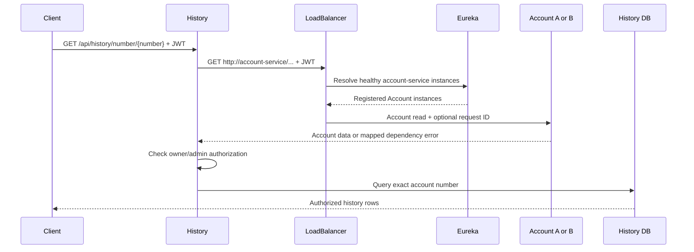

# TH7 — Eureka Service Discovery and Load Balancing

## 1. Objective and scope

This TH7 increment removes fixed Account Service addresses from Transfer and Transaction History. Both callers resolve the Eureka service ID `account-service` through Spring Cloud LoadBalancer. The isolated fixture starts two Account instances and exercises registration, instance selection, recovery after instance loss, and the no-provider error contract.

The increment preserves the existing Account, Transfer, and History APIs, JWT authorization checks, database ownership, and Kafka transfer flow. It does not add the example Patient/Appointment or Product/Order systems. No production database, broker, Redis data, email provider, or customer data is used by the TH7 fixture.

## 2. Architecture

| Component | TH7 responsibility | Discovery behavior |
| --- | --- | --- |
| Discovery Service | Eureka registry | Receives service heartbeats and serves the instance registry |
| Account Service A and B | Existing Account API, shared Account schema, OTP and account operations | Register as `account-service` with distinct instance IDs |
| Transfer Service | Existing transfer preflight and saga API | Resolves `http://account-service` before each source/destination preflight |
| Transaction History Service | Existing history query and Kafka archive | Resolves `http://account-service` before checking account ownership |
| API Gateway | Existing client routing | Resolves service routes through Eureka |
| Notification Service | Existing event consumer | Starts for service registration, with Kafka listener auto-start disabled in this fixture |
| MySQL, Kafka, Redis | Existing infrastructure dependencies | One isolated volume set per TH7 run ID |

`bank-common` remains a library, not a service. Account A and B use the same schema and Redis instance so failover reads the same users and accounts. Each owning service continues to use its own database and credentials.

```mermaid
flowchart LR
    Client --> Gateway[API Gateway]
    Gateway --> Transfer[Transfer Service]
    Gateway --> History[Transaction History Service]
    Transfer --> LB[Spring Cloud LoadBalancer]
    History --> LB
    LB --> Eureka[Discovery Service / Eureka]
    LB --> AccountA[Account Service A]
    LB --> AccountB[Account Service B]
    AccountA --> AccountDB[(Account schema)]
    AccountB --> AccountDB
    Transfer --> TransferDB[(Transfer schema)]
    History --> HistoryDB[(History schema)]
    Transfer -. banking.transaction .-> Kafka[(Kafka)]
    Kafka -. events .-> AccountA
    Kafka -. events .-> AccountB
    Kafka -. archive .-> History
```

## 3. Request and failure behavior

Transfer uses a load-balanced `RestClient.Builder`; History uses a load-balanced `RestTemplate`. Both call the service URI `http://account-service`, use a 2-second connect timeout and a 3-second read timeout, and retain the existing status mapping. A missing account remains 404. An unavailable provider, timeout, invalid Account response, or other dependency error maps to the existing safe 503 response. Transfer performs both Account preflights before persisting or publishing the transaction, so a failed preflight must not add a transaction row or Kafka event.

History keeps both routes: `/api/history/number/{number}` and the numeric-ID alias `/api/history/{id}`. It still checks the Account owner before querying the History database. An optional valid lower-case UUID `X-TH7-Request-Id` is forwarded to Account; malformed values are ignored. The Account trace filter is enabled only in the TH7 fixture, accepts only canonical UUIDs on account-read routes, and writes the fixture instance ID and response status to application logs. It does not log account numbers, tokens, or response bodies.



## 4. Implementation map

- `transfer-service`: adds the Spring Cloud LoadBalancer starter, resolves Account by service ID, and keeps the existing timeouts and 404/503 behavior.
- `transaction-history-service`: adds the same starter, marks its existing `RestTemplate` as load-balanced, keeps service-ID calls, and forwards an optional validated request ID.
- `account-service`: adds the fixture-only trace filter and a focused filter test.
- `compose.th7-test.yml` and `Dockerfile.th7-test`: define the isolated dependencies and services. Only Account containers receive the private JWT key; other services receive the public key only. All published ports bind to loopback. Volumes have a per-run name.
- `scripts/th7.sh` and `scripts/th7-acceptance.py`: build/verify the backend, provision synthetic schemas, start the fixture, run the scenarios, and retain sanitized results. `stop` leaves data volumes intact for inspection.

## 5. Reproduction

Run from a WSL/Linux shell in the repository with Docker Compose, Java 17, Maven, OpenSSL, and Python 3 available:

```bash
bash scripts/th7.sh run
```

The script prints a generated `TH7_RUN_ID`, its output directory, and the corresponding stop command. Results are written under `D:\Codex\outputs\bank\th7\<run-id>` in the configured Windows/WSL environment. Private fixture keys and generated passwords stay under `D:\Codex\work\bank-th7-runs\<run-id>` and are not included in logs or evidence. To inspect or stop a retained fixture, reuse its printed ID:

```bash
bash scripts/th7.sh status <run-id>
bash scripts/th7.sh stop <run-id>
```

`stop` stops and removes the run's containers/network without removing its named data volumes. Do not substitute an existing project name or attach these containers to a real database, Kafka, Redis, Eureka registry, or email server.

## 6. Acceptance scenarios

The runner records each case and its request evidence in `e2e-summary.json` and `request-results.csv` under the run output directory.

| ID | Scenario | Acceptance condition |
| --- | --- | --- |
| TC01 | Registration | Gateway, Transfer, History, Notification, and two uniquely identified Account instances appear as `UP` in Eureka |
| TC02 | Existing API and business flow | Synthetic users authenticate; the account owner can read history, a different owner is denied, the numeric alias still works, and a synthetic transfer reaches `SUCCESS` and appears in owner history |
| TC03 | Load balancing | Twenty History reads return 200 and correlated Account logs confirm both Account instances handled requests |
| TC04 | One Account instance fails | After Account A is killed and Eureka converges, five consecutive History reads and a Kafka-backed transfer are served through Account B |
| TC05 | No Account provider | After both Account instances are killed and Eureka converges, History and Transfer return 503; Transfer row count and Kafka transaction offset remain unchanged |
| TC06 | Account recovery | Restarted Account instances become healthy, both re-register, and both resume serving traced reads |
| TC07 | Eureka recovery | History continues using its cached Account registration while Eureka is stopped; after Eureka restarts, both Accounts register and History succeeds again |

These scenarios check instance selection and recovery with synthetic local services. They do not establish production availability, security certification, throughput, or cross-database/Kafka atomicity.

## 7. Verification record

Final verification on 2026-11-16 UTC used run `th7-20261116t070517z-5d23ba96`:

- `mvn verify` passed for all seven backend modules: `bank-common`, `account-service`, `transfer-service`, `transaction-history-service`, `notification-service`, `api-gateway`, and `discovery-service`.
- The modules with test suites reported 74 tests passed, 0 failures, and 0 skipped: Account 20, Transfer 38, History 16. The other four modules reported `BUILD SUCCESS`.
- E2E acceptance TC01–TC07 all passed; the summary records 160 requests. This includes balancing across both Account instances, surviving-instance failover, safe 503 responses with unchanged database row count and Kafka offset when no provider is available, Account recovery, and Eureka recovery.
- Evidence: `D:\Codex\outputs\bank\th7\th7-20261116t070517z-5d23ba96\` (`e2e-summary.json`, `request-results.csv`, module verification logs, and runner logs). Earlier partial attempts remain in `D:\Codex\outputs\bank\th7\th7-20261116t063234z-4402c16f\` for diagnosis; they are not counted as final acceptance.
- `bash scripts/th7.sh stop th7-20261116t070517z-5d23ba96` exited 0 after acceptance. It removed that run's containers and network while retaining its MySQL, Kafka, and Redis volumes. The pre-existing TH4 MySQL, Kafka, and Redis containers remained running.

## 8. Limitations and follow-up

- The fixture explicitly declares Account A and B so each can have a distinct Eureka instance ID and test-only host port. It does not alter the normal deployment's replica count or host port mappings.
- Eureka's test fixture disables self-preservation, refreshes the registry cache every second, and uses a 15-second Account lease so instance removal is observable on a short test timeline. This tuning is local to `compose.th7-test.yml`.
- The Notification listener is disabled in the fixture so OTP/transfer events cannot contact SMTP. Notification service startup and registry membership are exercised, but message delivery is not.
- The trace filter is opt-in and scoped to the TH7 fixture. It is test evidence instrumentation, not a general request tracing or metrics solution.
- Existing limitations in saga consistency, database/Kafka atomicity, and application security remain outside this week's scope.
