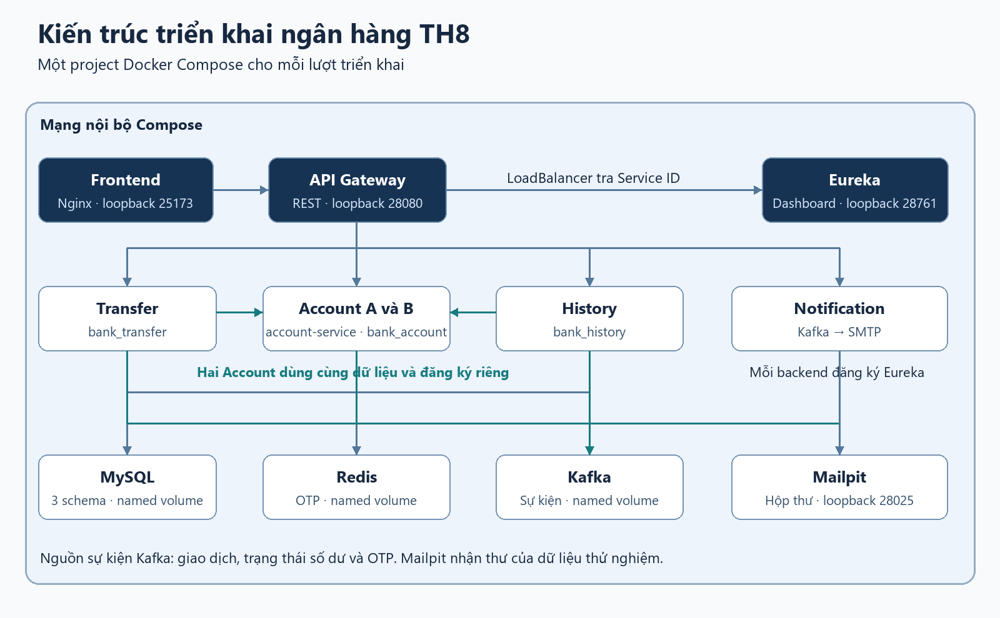

# Kiến trúc triển khai TH8

| Thành phần | Trách nhiệm | Dữ liệu do service sở hữu | Consumer | Provider | Số instance |
| --- | --- | --- | --- | --- | --- |
| Frontend | Giao diện ngân hàng và proxy cùng origin | — | Trình duyệt | Gateway | 1 |
| Gateway | Định tuyến theo Service ID | — | Frontend, API client | Eureka, bốn service nghiệp vụ | 1 |
| Eureka | Registry | Registry trong bộ nhớ | Gateway, services | — | 1 |
| Account | Xác thực, tài khoản, khoản vay, số dư | `bank_account`, Redis OTP | Gateway, Transfer, History | Eureka, MySQL, Redis, Kafka | 2 |
| Transfer | Khởi tạo và điều phối chuyển tiền | `bank_transfer` | Gateway, Kafka | Eureka, Account, MySQL, Kafka | 1 |
| History | Lưu và trả nhật ký chuyển tiền theo quyền | `bank_history` | Gateway, Kafka | Eureka, Account, MySQL, Kafka | 1 |
| Notification | Nhận sự kiện và chuyển thư thử nghiệm | — | Kafka | Eureka, Kafka, Mailpit | 1 |

Hai instance Account đăng ký cùng `account-service` với ID riêng và dùng chung schema, Redis và consumer group. Transfer và History phân giải ID này bằng Spring Cloud LoadBalancer. Chứng minh cân bằng qua UUID tương quan ở log Account và xác minh lại giao dịch qua History. `bank-common` là thư viện Maven.

Mỗi lượt dùng một mạng Compose và ba named volume (MySQL, Kafka, Redis). Ba schema dùng cùng MySQL container, với danh tính và quyền truy cập riêng. Các ứng dụng chỉ kết nối bằng DNS nội bộ. Chỉ frontend, Gateway, Eureka và trang Mailpit có cổng host loopback. Mailpit giữ email giả trong môi trường demo; Notification vẫn tiêu thụ Kafka. Frontend dùng REST qua Gateway. Cập nhật qua WebSocket cũ cần cấu hình và kiểm thử riêng.

Các ứng dụng Java dùng chung mẫu Dockerfile multi-stage theo module. Image Account dùng cho cả hai instance. Keys mount theo quyền của service; giá trị cấu hình riêng từng lượt ở ngoài repo. Eureka rút ngắn thời gian quan sát membership và tắt self-preservation trong stack lab.
