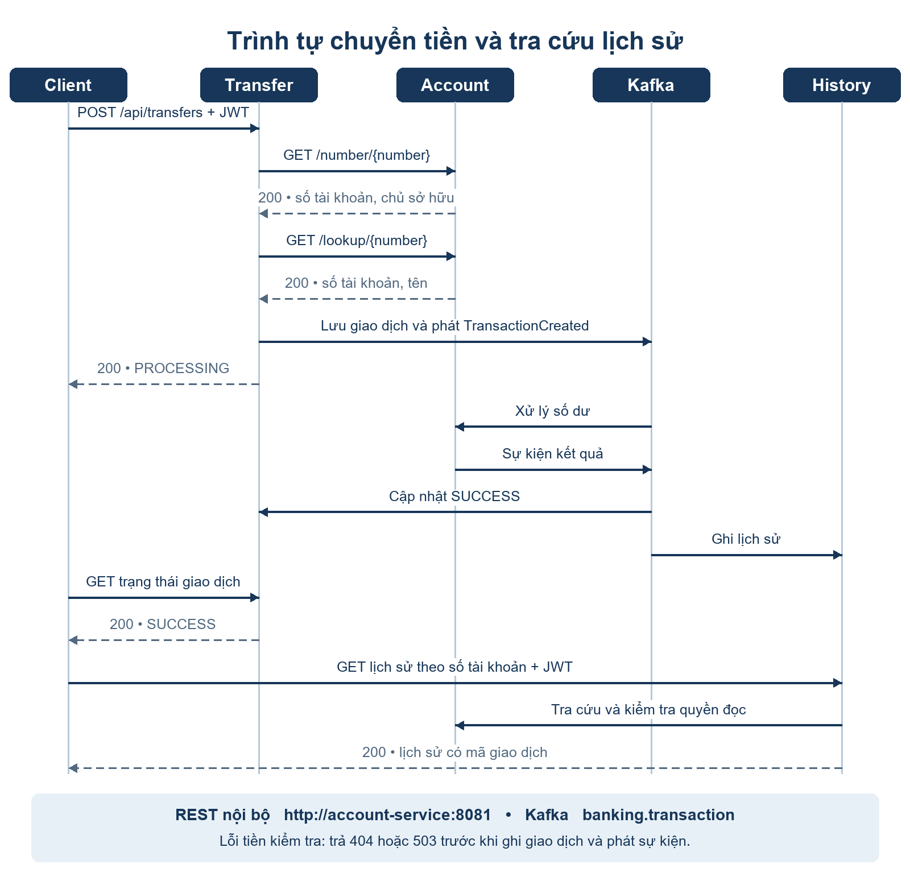

# Thiết kế tích hợp chuyển tiền qua REST

Transfer Service cần xác minh tài khoản nguồn thuộc người đang đăng nhập và tài khoản đích tồn tại trước khi ghi giao dịch. Account Service sở hữu dữ liệu tài khoản và cung cấp hai API tra cứu. Transfer là Consumer, gọi hai API qua Spring RestClient và chuyển tiếp Bearer JWT. History Service cũng gọi Account qua REST để kiểm tra quyền khi đọc lịch sử.

Fixture cấu hình `ACCOUNT_SERVICE_URL=http://account-service:8081` cho Transfer và History. Tên máy chủ là DNS nội bộ Docker Compose. Khi chạy các tiến trình trên máy, mặc định là `http://localhost:8081`. Fixture chỉ có một Account instance và tắt Eureka.

Sau tiền kiểm tra, Transfer lưu giao dịch và phát sự kiện Kafka. Account xử lý số dư và phát sự kiện kết quả. Transfer cập nhật trạng thái. History lưu sự kiện và cho phép chủ tài khoản truy vấn đúng tài khoản của mình. Mỗi service giữ schema riêng.

Account trả 404 khi tài khoản thiếu. Transfer giữ 404 cho lỗi đó và trả 503 khi kết nối thất bại, timeout hoặc phản hồi Account sai hợp đồng. RestClient giới hạn kết nối 2 giây và đọc 3 giây. Hai lỗi tại bước tiền kiểm tra kết thúc yêu cầu trước khi lưu giao dịch mới hoặc phát sự kiện. JWT kế thừa TH5.

